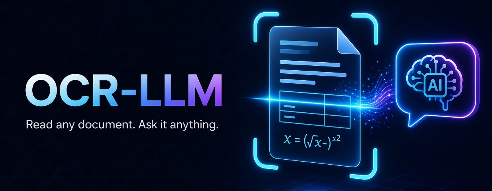
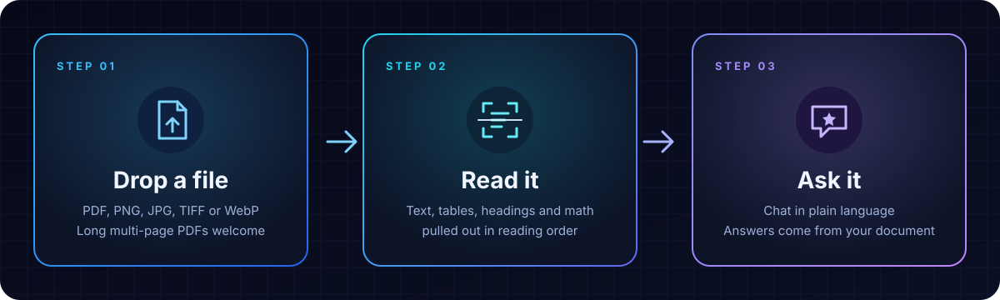
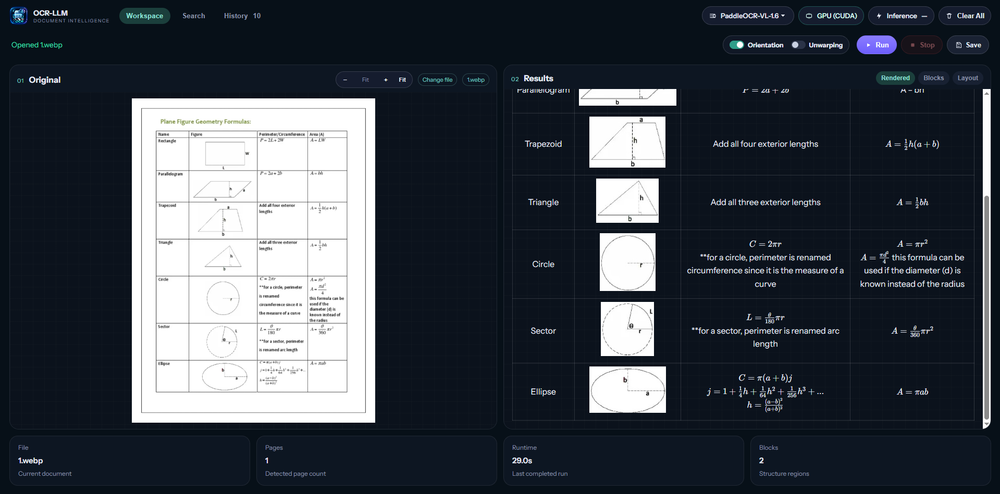
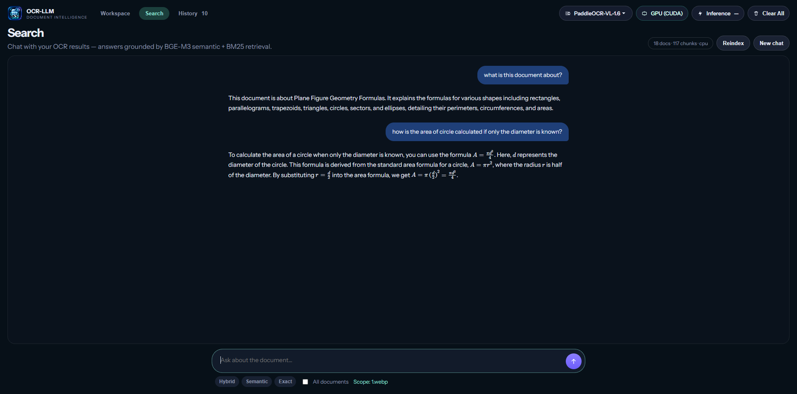
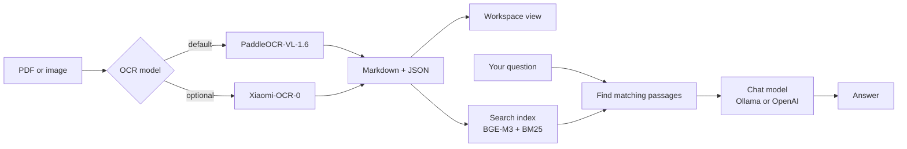

<div align="center">



<h3>Read any document. Ask it anything.</h3>

<p>
OCR-LLM turns PDFs and images into clean, searchable text on your own computer,<br/>
then lets you chat with what it found.
</p>


[What it does](#what-it-does) ·
[Screenshots](#screenshots) ·
[Quick start](#quick-start) ·
[How to use](#how-to-use) ·
[Settings](#settings) ·
[API](#api)

</div>

---

## What it does

<p align="center">

</p>

<p align="center">
<b>From a scanned page to a conversation in under a minute.</b><br/>
<sub>No copy-pasting, no retyping tables, no guessing what a blurry formula says.</sub>
</p>

<table>
<tr>
<td width="33%" valign="top">

#### Drop anything

Scans, phone photos, screenshots or a 30-page research paper. PDF, PNG, JPG, BMP, TIFF and WebP all work.

</td>
<td width="33%" valign="top">

#### See it decoded

Watch headings, tables and equations appear side by side with the original, with formulas rendered as real math.

</td>
<td width="33%" valign="top">

#### Get real answers

Ask *"What is this about?"* or *"How is the area of a circle calculated?"* and get answers taken from the page, not made up.

</td>
</tr>
</table>

> **Private by design.** Every step runs on your own machine. Your documents never leave it.

## Screenshots

<table>
<tr>
<td width="50%" align="center"><b>Workspace</b><br/><sub>The original page next to its OCR result</sub></td>
<td width="50%" align="center"><b>Search</b><br/><sub>Asking questions about the same page</sub></td>
</tr>
<tr>
<td></td>
<td></td>
</tr>
</table>

<p align="center"><sub>Sample: a plane-geometry formula sheet, read by PaddleOCR-VL-1.6 and answered by <code>qwen2.5:3b</code>.</sub></p>

## Features

| | |
|---|---|
| **Accurate OCR** | Text, tables, headings and figures, with formulas rendered as real math |
| **Two OCR models** | Switch between **PaddleOCR-VL-1.6** and **Xiaomi-OCR-0** from the top bar |
| **Layout view** | See the detected regions drawn on each page (PaddleOCR-VL) |
| **Fix bad scans** | Optional *Orientation* and *Unwarping* straighten rotated or curved photos |
| **Chat with documents** | Ask questions about one file or all of them; follow-ups remember the conversation |
| **Smart search** | Combines meaning-based search (BGE-M3) with exact keyword search (BM25) |
| **History** | Reopen or delete recent runs |
| **Save** | Export Markdown, JSON and images to a dated folder under `results/` |

---

## Quick start

> **You need:** Python 3.10 or 3.11. An NVIDIA GPU is strongly recommended; a 6 GB card is enough.

**1. Create an environment**

```bash
python -m venv .venv
.venv\Scripts\activate            # Linux / macOS: source .venv/bin/activate
python -m pip install -U pip
```

**2. Install**

```bash
# PaddlePaddle for your hardware (GPU with CUDA 12.6 shown; see below for CPU)
python -m pip install paddlepaddle-gpu==3.2.1 -i https://www.paddlepaddle.org.cn/packages/stable/cu126/

# PyTorch with CUDA (on Windows, plain pip would install the CPU-only build)
python -m pip install torch==2.14.0 torchvision==0.29.0 --index-url https://download.pytorch.org/whl/cu126

python -m pip install -r requirements.txt
```

**3. Run**

```bash
uvicorn app.main:app --host 0.0.0.0 --port 8000
```

Open **http://127.0.0.1:8000**, drop a file and press **Run**. The first run downloads the model, so it takes longer.

### Xiaomi-OCR-0 model (optional)

Only needed if you want to use **Xiaomi-OCR-0**. If the folder below is empty, the app downloads the model (about 1.7 GB) from Hugging Face the first time you select it. To use a copy you already have, or to work offline, download [xiaomi-research/Xiaomi-OCR-0](https://huggingface.co/xiaomi-research/Xiaomi-OCR-0) and place its files here:

```text
models/
└── Xiaomi-OCR-0/
    ├── model.safetensors        # about 1.6 GB
    ├── config.json
    ├── processor_config.json
    ├── tokenizer.json
    ├── tokenizer_config.json
    └── chat_template.jinja
```

```bash
# Optional: download it into the folder with the Hugging Face CLI
hf download xiaomi-research/Xiaomi-OCR-0 --local-dir models/Xiaomi-OCR-0
```

The app uses this folder automatically when `model.safetensors` is present. To keep the model somewhere else, set `XIAOMI_OCR_MODEL` to that folder's path.

<details>
<summary><b>Installing on CPU, or installing PyTorch yourself</b></summary>

<br/>

**PaddlePaddle.** Install exactly one build. Never install the CPU and GPU builds together.

```bash
# CPU only
python -m pip install paddlepaddle==3.2.1 -i https://www.paddlepaddle.org.cn/packages/stable/cpu/

# NVIDIA GPU, CUDA 12.6
python -m pip install paddlepaddle-gpu==3.2.1 -i https://www.paddlepaddle.org.cn/packages/stable/cu126/
```

**PyTorch.** `requirements.txt` pins Torch 2.14 together with `nvidia-cudnn-cu12==9.10.2.21`, so both OCR models can share one process. Keep that cuDNN version if you change Torch. On a CPU-only machine, skip the PyTorch step above; `requirements.txt` installs the CPU build.

**Conda.** A Conda environment works the same way. Activate it instead of `.venv`.

</details>

### Turn on chat answers (optional)

Search works without a chat model, but answers are much better with one. The easiest option is [Ollama](https://ollama.com):

```powershell
winget install --id Ollama.Ollama -e
ollama pull qwen2.5:3b
# Give the model enough room for the document passages
[Environment]::SetEnvironmentVariable('OLLAMA_CONTEXT_LENGTH','8192','User')
```

Restart Ollama, then start OCR-LLM with the model connected:

```powershell
$env:LLM_BASE_URL='http://127.0.0.1:11434/v1'; $env:LLM_MODEL='qwen2.5:3b'
$env:PADDLEOCR_DEVICE='gpu:0'; $env:RAG_DEVICE='cpu'
python -m uvicorn app.main:app --host 127.0.0.1 --port 8000
```

> **Tip:** `qwen2.5:3b` fits beside the OCR model on a 6 GB GPU. A bigger model such as `qwen2.5:7b`, or a hosted API, gives better answers if you have the memory or a key.

---

## How to use

### Workspace

1. **Choose a model** in the top bar. PaddleOCR-VL-1.6 is selected by default.
2. **Drop a file** (or click *Choose file*), then press **Run**. Press **Stop** to cancel.
3. **Read the result** in one of three tabs:
   - **Rendered** shows formatted text, tables and math
   - **Blocks** lists every detected region
   - **Layout** draws those regions on the page (PaddleOCR-VL only)
4. **Save** exports the run to `results/<filename>_<date-time>/` and offers to open the folder.

Switching models clears the current results, so you can run the same file again with the other model.

### Fixing rotated or curved pages

| Switch | Turns on | Use it when |
|--------|----------|-------------|
| **Orientation** | `use_doc_orientation_classify` | A page is sideways or upside down |
| **Unwarping** | `use_doc_unwarping` | A photo of a page is curved or skewed |

These are PaddleOCR-VL options and are disabled for Xiaomi-OCR-0. Changing them never reloads the model, and your choice is remembered in the browser.

### Search

| | |
|---|---|
| **What it searches** | The document open in Workspace. Tick **All documents** to search every run. |
| **Conversations** | Each document keeps its own chat. Follow-up questions use the earlier turns. |
| **Search mode** | **Hybrid** (default) combines both methods. **Semantic** matches meaning. **Exact** matches keywords. |
| **New chat** | Clears the current document's conversation. |
| **Reindex** | Rebuilds the search index if results look out of date. |

Chats are stored in the browser tab, so closing the tab clears them.

### Choosing an OCR model

| Model | Best for | Notes |
|-------|----------|-------|
| **PaddleOCR-VL-1.6** (default) | Most documents, layout analysis | Shows the Layout view and supports Orientation and Unwarping |
| **Xiaomi-OCR-0** | A second opinion on hard pages | Reads the whole page at once; no layout view. Uses `models/Xiaomi-OCR-0/` if present, otherwise downloads it ([setup](#xiaomi-ocr-0-model-optional)) |

Only one model is kept in GPU memory at a time. Switching unloads the other one.

## How it works



---

## Settings

OCR-LLM is configured with environment variables. `.env.example` lists the common ones with their defaults. The app does not read a `.env` file by itself, so set them in your shell or process manager.

<details>
<summary><b>OCR</b></summary>

<br/>

| Variable | Default | What it does |
|----------|---------|--------------|
| `PADDLEOCR_ENGINE` | `paddle` | Model selected at startup: `paddle` or `xiaomi` |
| `PADDLEOCR_VL_VERSION` | `v1.6` | PaddleOCR-VL version |
| `PADDLEOCR_DEVICE` | *(auto)* | `gpu:0` or `cpu`; picks the GPU automatically when unset |
| `XIAOMI_OCR_MODEL` | `xiaomi-research/Xiaomi-OCR-0` | Hugging Face ID or local folder |
| `ENABLE_ORIENTATION` | `true` | First-time default for the Orientation switch |
| `ENABLE_UNWARPING` | `true` | First-time default for the Unwarping switch |
| `MAX_UPLOAD_MB` | `100` | Largest file you can upload |
| `DATA_DIR` / `EXPORT_DIR` | `data/` / `results/` | Working files / saved exports |

</details>

<details>
<summary><b>Search</b></summary>

<br/>

| Variable | Default | What it does |
|----------|---------|--------------|
| `BGE_M3_MODEL` | `BAAI/bge-m3` | Embedding model used for meaning-based search |
| `RAG_DEVICE` | `cpu` | Where embeddings run; CPU keeps the GPU free for OCR |
| `RAG_CHUNK_CHARS` | `900` | Size of each indexed passage, in characters |
| `RAG_CHUNK_OVERLAP` | `120` | Overlap between passages |
| `RAG_TOP_K` | `8` | Passages retrieved per question |
| `RAG_RRF_K` | `60` | How Hybrid mode blends the two search methods |
| `RAG_AUTO_INDEX` | `true` | Index each run automatically when it finishes |
| `RAG_DIR` | `data/rag/` | Where the index is stored |

</details>

<details>
<summary><b>Chat model</b></summary>

<br/>

| Variable | Default | What it does |
|----------|---------|--------------|
| `LLM_BASE_URL` | *(empty)* | OpenAI-compatible endpoint, e.g. `http://127.0.0.1:11434/v1` for Ollama |
| `LLM_API_KEY` | *(empty)* | API key (falls back to `OPENAI_API_KEY`); local servers need none |
| `LLM_MODEL` | *(empty)* | Model name; leave empty to use the built-in extractive answers |
| `LLM_TIMEOUT` | `120` | Request timeout in seconds |
| `LLM_MAX_TOKENS` | `700` | Longest answer |
| `LLM_TEMPERATURE` | `0.2` | Lower is more factual |
| `LLM_CONTEXT_HITS` | `8` | Passages sent to the model |
| `LLM_HISTORY_TURNS` | `6` | Earlier chat turns sent with each question |

```env
# OpenAI
LLM_MODEL=gpt-4o-mini
LLM_API_KEY=sk-...

# Local Ollama or LM Studio
LLM_BASE_URL=http://127.0.0.1:11434/v1
LLM_MODEL=qwen2.5:3b
```

**How answers are made.** The model follows the prompt in [`app/rag/prompts/answer_system.md`](app/rag/prompts/answer_system.md) and receives the question type, a short outline of the document, the best-matching passages and recent chat turns. If no model is set, or the call fails, OCR-LLM builds an answer from the matching sentences instead and says so in the chat.

</details>

---

## API

Everything the UI does is available over HTTP.

<details>
<summary><b>Health and model</b></summary>

<br/>

```bash
curl http://127.0.0.1:8000/api/health        # device, current model, busy state

curl -X POST http://127.0.0.1:8000/api/engine \
  -H "Content-Type: application/json" \
  -d "{\"engine\":\"paddle\"}"                # or "xiaomi"; refused while a run is in progress
```

</details>

<details>
<summary><b>Jobs (used by the UI)</b></summary>

<br/>

```bash
# Start a run; the two preprocessing fields are optional
curl -X POST http://127.0.0.1:8000/api/jobs -F "file=@sample.pdf" \
  -F "use_doc_orientation_classify=true" -F "use_doc_unwarping=false"

# Check progress and get the result
curl "http://127.0.0.1:8000/api/jobs/<job_id>?include_result=true"

# Cancel, save or delete
curl -X POST   http://127.0.0.1:8000/api/jobs/<job_id>/cancel
curl -X POST   http://127.0.0.1:8000/api/jobs/<job_id>/save
curl -X DELETE http://127.0.0.1:8000/api/jobs/<job_id>

# Clear the whole history
curl -X DELETE http://127.0.0.1:8000/api/jobs
```

</details>

<details>
<summary><b>One-shot parse</b></summary>

<br/>

```bash
curl -X POST http://127.0.0.1:8000/api/parse \
  -F "file=@sample.pdf" -F "use_doc_unwarping=false"
```

Waits for the run to finish and returns Markdown, structured JSON, page count, run time and download links under `/results/<job_id>/…`.

</details>

<details>
<summary><b>Search</b></summary>

<br/>

```bash
curl http://127.0.0.1:8000/api/rag/health

# Ask about one document; "history" carries earlier turns for follow-ups
curl -X POST http://127.0.0.1:8000/api/rag/ask \
  -H "Content-Type: application/json" \
  -d "{\"query\":\"How is it different from adaptive width?\",\"mode\":\"hybrid\",\"top_k\":12,\"job_id\":\"<job_id>\",\"history\":[{\"role\":\"user\",\"content\":\"What is adaptive depth?\"},{\"role\":\"assistant\",\"content\":\"...\"}]}"

# Rebuild the index (leave out job_id to rebuild everything)
curl -X POST http://127.0.0.1:8000/api/rag/reindex \
  -H "Content-Type: application/json" \
  -d "{\"job_id\":\"<job_id>\",\"force\":true}"
```

`/api/rag/ask` returns the `answer`, the `question_type`, the `answer_source` (model name, `extractive` or `none`) and the matching `results`. Leave out `job_id` to search every document.

</details>

---

<details>
<summary><b>Where files are stored</b></summary>

<br/>

```text
results/<filename>_<YYYY-MM-DD_HH-MM-SS>/     # created when you press Save
├── <filename>.md
├── <filename>.json
├── <filename>.<ext>                          # the original file
└── page_0001/
    ├── model outputs
    └── visualizations/                       # layout images, when available

data/
├── uploads/<job_id>/                         # uploaded files
├── results/<job_id>/                         # working folder for each run
└── rag/                                      # search index

models/
└── Xiaomi-OCR-0/                             # optional local copy of the model
```

`data/` and `results/` are created automatically on first start. `models/` is optional: if `models/Xiaomi-OCR-0/model.safetensors` is missing, the model is downloaded from Hugging Face the first time you pick it.

</details>

<details>
<summary><b>Docker</b></summary>

<br/>

The included `Dockerfile` installs the CPU build of PaddlePaddle. For a GPU host, replace that line with the `paddlepaddle-gpu` wheel for your CUDA version.

```bash
docker build -t ocr-llm .
docker run --rm -p 8000:8000 ocr-llm
```

</details>

<details>
<summary><b>Running for many users</b></summary>

<br/>

- Runs are processed one at a time so they never run out of GPU memory. For many simultaneous users, move OCR to a dedicated serving backend and keep FastAPI as the API and UI layer.
- The main page is sent with `Cache-Control: no-cache`, so UI updates show up on a normal reload.

</details>

<br/>

<div align="center">
<sub><b>OCR-LLM</b> · built with PaddleOCR-VL, Xiaomi-OCR-0, BGE-M3, FastAPI and KaTeX</sub>
</div>


---

## 👤 Author

**Noman Raza Shah** — [GitHub @NomanShahRaza](https://github.com/NomanShahRaza)

If you find this project useful, please consider giving it a ⭐!
